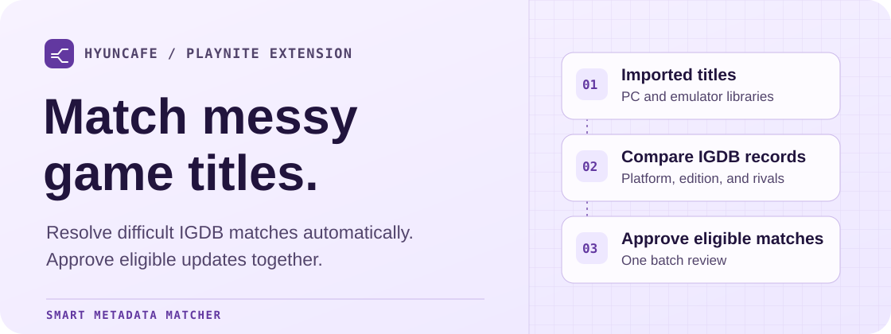
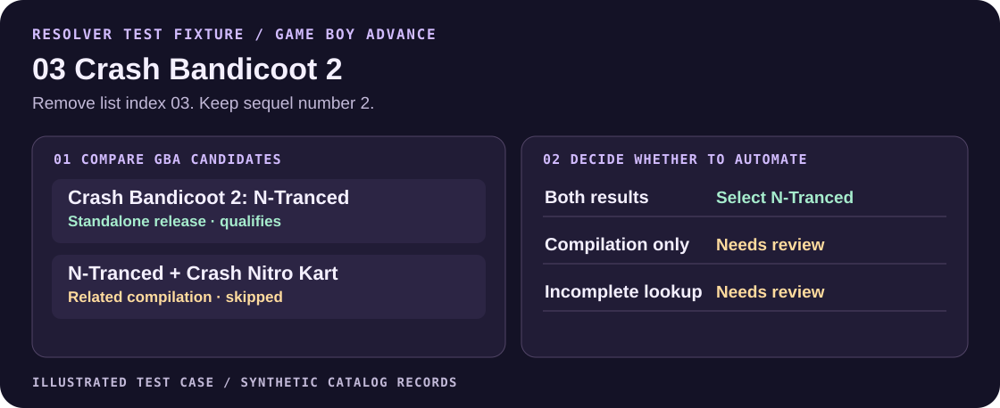

<p align="center">
  <picture>
    <source media="(prefers-color-scheme: dark)" srcset="Docs/readme/hero-dark.svg">
    <source media="(prefers-color-scheme: light)" srcset="Docs/readme/hero-light.svg">
    
  </picture>
</p>

<h1 align="center">Smart Metadata Matcher</h1>

<p align="center">
  Automatically identify games in messy PC and emulator libraries, then fill in missing Playnite metadata with one batch approval.
</p>

<p align="center">
  <a href="https://github.com/HyunCafe/SmartMetadataMatcher-Public/releases/tag/v0.5.17-beta.1"></a>
</p>

<p align="center">
  <a href="#quick-start"><strong>Quick start</strong></a> ·
  <a href="#how-matching-works"><strong>Matching engine</strong></a> ·
  <a href="#example-crash-bandicoot-2-on-gba"><strong>Worked example</strong></a> ·
  <a href="https://github.com/HyunCafe/SmartMetadataMatcher-Public/issues"><strong>Issues</strong></a>
</p>

<p align="center"><strong>Playnite 10 Desktop on Windows · Twitch developer credentials required · MIT License</strong></p>

> [!NOTE]
> **Experimental public beta.** Distributed through GitHub Releases for Playnite 10 Desktop. Playnite 11 compatibility remains unverified.

## How matching works

Imported titles often carry list numbers, abbreviated subtitles, or inconsistent naming. Smart Metadata Matcher uses the existing Playnite title and platform to find the corresponding record in the **Internet Game Database (IGDB)**.

1. **Clean up the search title.** On supported systems, the matcher can remove a list index, expand a known alias, or recognize a redundant acronym. It preserves sequel numbers and meaningful edition markers.
2. **Look beyond the first search result.** Clear matches take a fast path. When the initial result is weak, the engine can run exact-title and platform-filtered prefix lookups, then combine the results by IGDB ID.
3. **Compare evidence and competing releases.** The expanded resolver checks the IGDB platform ID, title or alias, sequel and edition markers, playable release type, and platform-specific dates when available. It weighs the best candidate against its closest rival. If the expanded search hits its result cap, it cannot promote a match through that resolver.
4. **Gather eligible matches automatically.** The strict batch action selects fresh results that pass its evidence rules. Ambiguous, unmatched, and stale results stay outside that selection. You can approve the eligible batch together.

[Title and platform logic](Source/CatalogCore.cs) · [Expanded resolver](Source/CatalogSmartResolver.cs) · [Strict batch selection](Source/CatalogStrictBatchFlow.cs)

## Example: Crash Bandicoot 2 on GBA



The [resolver fixture](Tests/CatalogSmartResolverTests.cs#L115) starts with `03 Crash Bandicoot 2` and two plausible GBA records. The engine drops the list index `03`, keeps the sequel number `2`, and qualifies *Crash Bandicoot 2: N-Tranced* when the competing record is a compilation. If the compilation is the only result or the expanded lookup is incomplete, the shortened title stays outside automatic selection.

The fixture illustrates the matching rules. It uses synthetic catalog records and measures no live IGDB or Playnite comparison.

## How it compares with Playnite’s metadata download

Playnite can fetch metadata automatically during import, run a bulk download, or let you search manually. Its official IGDB provider sends the title, release year, library ID, and game ID for background lookups. Smart Metadata Matcher adds a separate workflow for libraries with imperfect local titles: it can recover a candidate through targeted searches, check whether competing records make that identity ambiguous, and gather qualifying games for a single approval. [Playnite metadata workflow][playnite] · [Official IGDB provider source][provider]

## Quick start

1. **Download the package.** From the [beta release][beta], download `SmartMetadataMatcher-0.5.17-beta.1.pext` and `SHA256SUMS.txt` under **Assets**.
2. **Verify the checksum.** In PowerShell, from your download folder, run the command below. Compare the result with the entry for the `.pext` in `SHA256SUMS.txt`.

   ```powershell
   Get-FileHash -Algorithm SHA256 -LiteralPath '.\SmartMetadataMatcher-0.5.17-beta.1.pext'
   ```

3. **Install and connect.** Open the `.pext` with Playnite and restart. Go to **Main menu → Extensions → Smart Metadata Matcher → Open Smart Metadata Matcher…**. Under **IGDB settings**, enter your own Twitch developer Client ID and Client Secret, run **Test Connection**, and save. See the [IGDB account setup guide][igdb].
4. **Start with a few games.** Back up your Playnite library and extension data. Scan a small batch. Use **Apply verified matches** to gather qualifying results, then preview and approve the changes. Use **Review matches** for uncertain entries.

## Batch imports and recovery

| Route | What happens before changes |
| --- | --- |
| **Apply verified matches** | Matcher gathers eligible fresh matches and shows the proposed changes for approval. It rechecks each chosen IGDB identity before writing that game. |
| **Fully reviewed bulk import** | After you confirm the selected identities, Matcher checks the entire reviewed selection against IGDB before the first write. |

Imports can fill missing descriptions, covers, backgrounds, and icons. Existing values stay in place by default. Display-title changes are optional and previewed. ROM contents and launch paths stay intact.

Cancellation stops between games. Completed changes remain applied, and supported changes can be undone per game when the recovery record and current fields allow it. Large-batch UI and interruption testing are still tracked in the [release criteria](Docs/RELEASE_GATE.md).

## Development

[Resolver fixtures](Tests/CatalogSmartResolverTests.cs) cover cases such as abbreviated sequels, competing compilations, and same-title games. [Recovery fixtures](Tests/CatalogRecoveryConsistencyTests.cs) cover consistency checks for interrupted operations.

<details>
<summary><strong>Build and test on Windows</strong></summary>

The extension targets .NET Framework 4.6.2 and references Playnite SDK 6.18.0. Use the .NET SDK and PowerShell 7.

```powershell
dotnet restore .\SmartMetadataMatcher.csproj --source https://api.nuget.org/v3/index.json
dotnet build .\SmartMetadataMatcher.csproj -c Release --no-restore
dotnet restore .\Tests\NameRulesTests.csproj --source https://api.nuget.org/v3/index.json
dotnet run --project .\Tests\NameRulesTests.csproj -c Release --no-restore
pwsh -NoLogo -NoProfile -File .\Tools\Package-Release.ps1
```

The packaging script creates a local `.pext`. See the [release criteria](Docs/RELEASE_GATE.md) for dependency and binary verification.

</details>

<details>
<summary><strong>Credentials, data and uninstalling</strong></summary>

IGDB lookups use your Twitch credentials and send game lookup terms to IGDB. Credentials are stored locally with Windows account encryption. See [Privacy](PRIVACY.md) for the network endpoints, local data and what diagnostic exports can contain.

To disable or uninstall the extension, open **Main menu → Add-ons → Installed**, then select **Smart Metadata Matcher**. Keep your extension data and backup if you may need the recovery history.

</details>

## Support and project status

- **Report a bug.** Include your Playnite version, extension version and steps to reproduce. Redact credentials, local paths and private library details. [Open an issue][issues]
- **See what changed.** Read the [beta release notes][beta] and the [source changelog](CHANGELOG.md).
- **Follow Playnite distribution.** The [add-on](Manifests/addon-database.yaml) and [installer](Manifests/installer.yaml) manifests are drafts for future submission. See the [official add-on database](https://github.com/JosefNemec/PlayniteAddonDatabase) for intake status.

[Privacy](PRIVACY.md) · [Security](SECURITY.md) · [MIT License](LICENSE)

Maintained by **HyunCafe**.

[beta]: https://github.com/HyunCafe/SmartMetadataMatcher-Public/releases/tag/v0.5.17-beta.1
[issues]: https://github.com/HyunCafe/SmartMetadataMatcher-Public/issues
[igdb]: https://api-docs.igdb.com/#account-creation
[playnite]: https://api.playnite.link/docs/manual/library/games/metadata.html
[provider]: https://github.com/JosefNemec/PlayniteExtensions/blob/master/source/Metadata/IGDBMetadata/IgdbLazyMetadataProvider.cs#L1839
