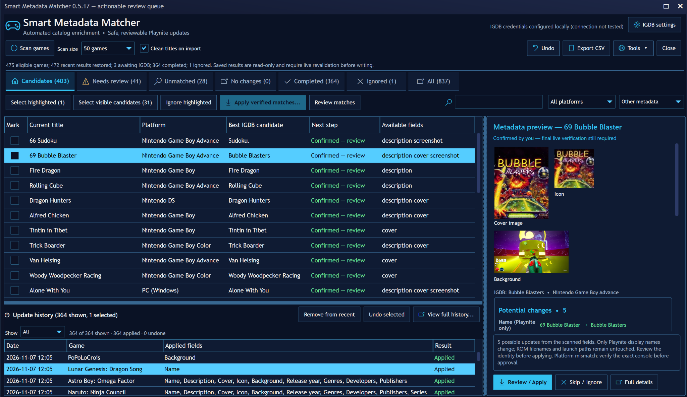

# Smart Metadata Matcher

**Match hard-to-identify PC and emulated games in Playnite.**

Compare IGDB candidates by title, platform, and edition. Review the matches and fill in missing artwork and descriptions in one batch.

**[Download the public beta][beta]** · [Quick start](#quick-start) · [Matching engine](#how-matching-works) · [Support](#support-and-project-status)

`Playnite 10 Desktop` · `Windows` · `Twitch developer credentials required`



*The v0.5.17 review queue shows candidate matches, proposed metadata, and update history. The selected entry was manually confirmed for review and still shows a platform warning.*

## What the matcher checks

| Case | What the code demonstrates |
| --- | --- |
| **Numbered sequels** | `Ys 1` can resolve to *Ys I* with a unique candidate on the correct platform. `Final Fantasy 4` and *Final Fantasy IV* normalize to the same title. *Mega Man X* stays distinct from *Mega Man 10*. |
| **Same-title ports** | *Blade Dancer: Lineage of Light* has same-name catalog entries. The resolver can favor the dated PSP original when the competing record is a linked port without its own dated PSP release. A conflicting local year or a port with its own PSP date leaves the case for review. |
| **Compilations and editions** | `Ys One And Two PSP` can resolve to the standard *Ys I & II Chronicles* bundle. If the lookup returns only the *Premium Edition*, the matcher withholds automatic selection. |
| **Ambiguous names** | `66 Sudoku` can refer to multiple GBA releases, including *Sudoku Fever* and *Sudoku Micro*. The automatic resolver leaves the entry for review. |

[Resolver tests](Tests/CatalogSmartResolverTests.cs) · [Matching logic](Source/CatalogSmartResolver.cs)

## Quick start

The beta is distributed through GitHub Releases. Playnite 11 compatibility remains unverified.

1. **Download the beta.** Get the `.pext` and `SHA256SUMS.txt` from the [release assets][beta].
2. **Verify the checksum.** Run this in PowerShell from your download folder and compare the result with `SHA256SUMS.txt`.

   ```powershell
   Get-FileHash -Algorithm SHA256 -LiteralPath '.\SmartMetadataMatcher-0.5.17-beta.1.pext'
   ```

3. **Install and connect.** Open the `.pext` with Playnite and restart. Go to **Main menu → Extensions → Smart Metadata Matcher → Open Smart Metadata Matcher…**. Under **IGDB settings**, enter your own Twitch developer Client ID and Client Secret, run **Test Connection**, and save. See the [IGDB account setup guide][igdb].
4. **Start with a few games.** Back up your Playnite library and extension data. Scan a small batch. Use **Apply verified matches** to gather qualifying results, then preview and approve the changes. Use **Review matches** for uncertain entries.

## How matching works

1. **Clean up the title.** Remove supported list prefixes and recognize known aliases while keeping sequel numbers and edition markers.
2. **Find and compare candidates.** If the initial match is weak, try exact-title and platform-filtered prefix lookups. Compare IGDB platform IDs, edition markers, release types, available dates, and competing records.
3. **Select the batch.** Gather fresh matches that meet the evidence rules. Leave ambiguous results for review and keep stale or unmatched entries out of automatic selection.

[Title and platform logic](Source/CatalogCore.cs) · [Expanded resolver](Source/CatalogSmartResolver.cs) · [Strict batch selection](Source/CatalogStrictBatchFlow.cs)

<details>
<summary><strong>How this differs from Playnite’s built-in metadata download</strong></summary>

Playnite supports automatic, bulk, and manual metadata downloads. Matcher adds a separate workflow for imperfect library titles. It runs targeted searches for weak matches, compares competing identities, and automatically gathers eligible games for batch approval. If the expanded lookup reaches its result cap, that resolver cannot promote the match.

[Playnite metadata workflow][playnite] · [Official IGDB provider source][provider]

</details>

## What changes in your library

| Route | What happens before changes |
| --- | --- |
| **Apply verified matches** | Matcher gathers eligible fresh matches and shows the proposed changes for approval. It rechecks each chosen IGDB identity before writing that game. |
| **Fully reviewed bulk import** | After you confirm the selected identities, Matcher checks the entire reviewed selection against IGDB before the first write. |

Imports can fill missing descriptions, covers, backgrounds, and icons. Existing values stay in place by default. Display-title changes are optional and previewed. ROM contents and launch paths stay intact.

Cancellation stops between games. Completed changes remain applied, and supported changes can be undone per game when the recovery record and current fields allow it. Large-batch UI and interruption testing are still tracked in the [release criteria](Docs/RELEASE_GATE.md).

## Development

[Resolver fixtures](Tests/CatalogSmartResolverTests.cs) cover cases such as abbreviated sequels, competing compilations, and same-title games. [Recovery fixtures](Tests/CatalogRecoveryConsistencyTests.cs) cover consistency checks for interrupted operations.

<details>
<summary><strong>Build and test on Windows</strong></summary>

The extension targets .NET Framework 4.6.2 and references Playnite SDK 6.18.0. Use the .NET SDK and PowerShell 7.

```powershell
dotnet restore .\SmartMetadataMatcher.csproj --source https://api.nuget.org/v3/index.json
dotnet build .\SmartMetadataMatcher.csproj -c Release --no-restore
dotnet restore .\Tests\NameRulesTests.csproj --source https://api.nuget.org/v3/index.json
dotnet run --project .\Tests\NameRulesTests.csproj -c Release --no-restore
pwsh -NoLogo -NoProfile -File .\Tools\Package-Release.ps1
```

The packaging script creates a local `.pext`. See the [release criteria](Docs/RELEASE_GATE.md) for dependency and binary verification.

</details>

<details>
<summary><strong>Credentials, data and uninstalling</strong></summary>

IGDB lookups use your Twitch credentials and send game lookup terms to IGDB. Credentials are stored locally with Windows account encryption. See [Privacy](PRIVACY.md) for the network endpoints, local data and what diagnostic exports can contain.

To disable or uninstall the extension, open **Main menu → Add-ons → Installed**, then select **Smart Metadata Matcher**. Keep your extension data and backup if you may need the recovery history.

</details>

## Support and project status

- **Report a bug.** Include your Playnite version, extension version and steps to reproduce. Redact credentials, local paths and private library details. [Open an issue][issues]
- **See what changed.** Read the [beta release notes][beta] and the [source changelog](CHANGELOG.md).
- **Follow Playnite distribution.** The [add-on](Manifests/addon-database.yaml) and [installer](Manifests/installer.yaml) manifests are drafts for future submission. See the [official add-on database](https://github.com/JosefNemec/PlayniteAddonDatabase) for intake status.

[Privacy](PRIVACY.md) · [Security](SECURITY.md) · [MIT License](LICENSE)

Maintained by **HyunCafe**.

[beta]: https://github.com/HyunCafe/SmartMetadataMatcher-Public/releases/tag/v0.5.17-beta.1
[issues]: https://github.com/HyunCafe/SmartMetadataMatcher-Public/issues
[igdb]: https://api-docs.igdb.com/#account-creation
[playnite]: https://api.playnite.link/docs/manual/library/games/metadata.html
[provider]: https://github.com/JosefNemec/PlayniteExtensions/blob/master/source/Metadata/IGDBMetadata/IgdbLazyMetadataProvider.cs#L1839
